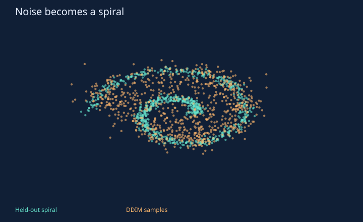
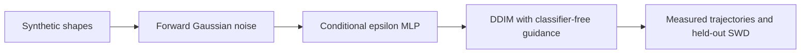

# Diffusion Playground

**Conditional generative modeling you can watch.**

[](https://github.com/aymaw/diffusion-playground/actions/workflows/ci.yml)
[](LICENSE)




New original, AI-assisted personal work, November 2026. All task data are synthetic.
No API key, pretrained download or private data is required. See [provenance](PROVENANCE.md).

## Run it

```bash
# Python 3.11–3.13. uv.lock freezes the dependency graph.
uv sync --frozen --extra dev
uv run pytest -q
uv run python -m diffusionlab.experiment --out runs/reference
uv run python -m http.server 8765 --bind 127.0.0.1
```

Open `http://127.0.0.1:8765/runs/reference/demo.html` for the new run, or
`http://127.0.0.1:8765/results/demo.html` for the committed measured report.
The self-contained HTML also opens directly from disk. Stop the local server with Ctrl+C.

For a short correctness run, add `--quick --out runs/smoke`. Quick output is explicitly
labeled and is not the committed reference result. Training and checkpoints stay in
ignored `runs/`; reports include seeds/configuration, raw metrics and environment details.

## Inside the experiment

A small PyTorch epsilon-prediction MLP learns three distributions: a ring, a spiral,
and eight Gaussian blobs. Class embeddings include a null condition; training drops
15% of labels. The same model therefore learns conditional and unconditional noise
predictions. Sampling combines them as
`epsilon_null + guidance * (epsilon_class - epsilon_null)`.
Guidance 0 is unconditional; 1 is ordinary conditional sampling; values above 1
extrapolate. Stronger guidance is not automatically better.

The forward process is `x_t = sqrt(alpha_bar_t) x_0 + sqrt(1-alpha_bar_t) epsilon`.
The 128-step linear beta schedule spans 0.0001 to 0.08 and ends close to a standard
normal. Training minimizes noise MSE with AdamW and gradient clipping. Sampling
uses the deterministic, eta=0 DDIM update; this repository does not implement a
separate ancestral DDPM sampler. The final step uses `alpha_bar_previous = 1`.



## Measured result

| DDIM steps | Guidance | Mean conditional SWD ↓ | Seed SD |
| --- | --- | --- | --- |
| 32 | 0.0 | 0.1978 | 0.0046 |
| 32 | 1.0 | 0.114 | 0.009 |
| 32 | 2.0 | 0.1874 | 0.0321 |
| 128 | 1.0 | 0.1121 | 0.0067 |


Three independent model seeds, 4,000 updates each, 8,192 training examples, batch
256, and 768 held-out/generated points per class. Reference samples use independent
seeds and never enter the optimizer. Guidance and sampler settings are fixed
comparisons, not selected on a hidden benchmark. SWD is averaged over 128 seeded
projection directions and three classes; it is not FID, image quality, or likelihood.
All seed-level distances and training-loss snapshots are retained in `metrics.json`.

## Visual demo

Scrub a real 32-step reverse trajectory, switch guidance, or play the denoising
animation. The visible points are a 64-sample slice from the first trained seed,
not all samples used for evaluation. The HTML is self-contained and needs no API.
Generated checkpoints stay in ignored `runs/`; no weights are shipped in this repo.
They contain state dict, width, schedule length, seed and update count. Reload with
`Denoiser(width=96, steps=128)` and `torch.load(path, weights_only=True)`.

## Tests and limits

Tests cover exact forward noise and oracle-epsilon reconstruction, schedule
monotonicity, parameter updates, save/reload determinism, null-conditioning behavior,
invalid sampling controls, and distribution-distance invariants. This is a CPU,
two-dimensional generative-model laboratory, not a text-to-image system. Sparse
loss snapshots are diagnostics rather than validation curves or convergence proof.
No GPU benchmark, EMA ablation, pretrained model, image data or clinical task is claimed.

## Method references

- [Ho et al., Denoising Diffusion Probabilistic Models](https://arxiv.org/abs/2006.11239).
- [Song et al., Denoising Diffusion Implicit Models](https://arxiv.org/abs/2010.02502).
- [Ho & Salimans, Classifier-Free Diffusion Guidance](https://arxiv.org/abs/2207.12598).

## Code map

- `src/diffusionlab/core.py`: mathematical and inference primitives.
- `src/diffusionlab/experiment.py`: seeded experiment and CLI.
- `src/diffusionlab/visual.py`: dependency-free HTML/SVG reports.
- `tests/`: mathematical checks and failure-path regressions.
- `results/`: executed measurements, static preview, interactive report and provenance.
- `.github/workflows/ci.yml`: frozen install, lint, tests, quick experiment and package build on three Python versions.

Original implementation and generated fixtures: [MIT](LICENSE).
